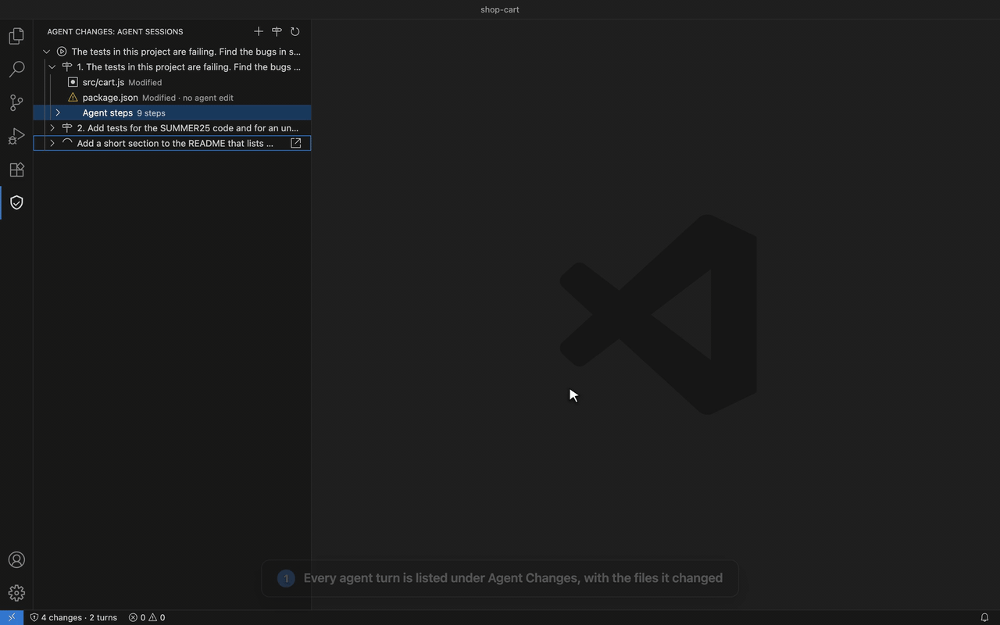

# Changelog

All notable changes to the Agent Change Guard extension are documented here.

## [0.2.6] — 2026-11-17

**How to use Turn Flow:** open **Agent Changes** in the activity bar, hover a
turn and click its flow icon, then press **Replay**. Click a changed file to
see what that turn changed, and use **‹ ›** to move between turns.
[Full-quality video (MP4)](docs/images/turn-flow-demo.mp4) ·
[Screenshot](docs/images/turn-flow.png)

### Added

- **Turn Flow** (`Agent Change Guard: Show Turn Flow`): a flowchart of one
  agent turn, from the user message through every step the agent took (reads,
  searches, edits, commands, subagents and their steps, web calls) to the files
  that changed, with an animated replay, live updates for the turn in progress,
  click-through to diffs, and navigation between turns. Opened from the flow
  icon on a turn, the current turn, or a session's context menu.
- **Agent steps** in the sidebar: each Claude Code or Codex turn lists the
  steps the agent took; clicking one opens the turn diff of the file it wrote
  or the file it read.
- **Unattributed change warnings**: files a finished turn changed that no
  recorded agent step wrote (for example a shell command, formatter, or build
  step) are marked "no agent edit" in the sidebar and called out in Turn Flow.
  Claude Code's own record of files a Bash command edited counts as a write.
  So does Codex's own record of the files each patch changed.

### Fixed

- **Codex turns were not detected** with current Codex versions, which record
  user messages in a newer format (and rewrite older rollouts into it). Both
  formats are now recognised, so Codex turns become checkpoints again.
- Codex's own subagents (such as the approval reviewer) no longer start new
  turns: their rollouts share the workspace folder but are skipped.
- Turns recorded before Codex rewrote a rollout are found again: when a
  turn's message has moved to another line, it is located by its text.
- **The first Claude Code message in a new project was missed.** In a folder
  where Claude Code had never been used, that first turn (and its changes)
  was skipped as if it were old history. It now starts a turn like any other.

## [0.2.5] — 2026-06-16

### Changed

- Improved Marketplace/Open VSX search metadata so the extension is easier to
  find for agent, AI agent, Claude Code, Codex, Cursor Agent, diff, and revert
  searches.

## [0.2.4] — 2026-06-15

### Added

- **Open Original Message** action for Claude Code and Codex turns. The action
  opens the closest supported platform session/thread link and keeps the exact
  local transcript line as fallback.

### Changed

- Refined the marketplace icon so the shield mark is centered and no longer
  shows the extra outer circle/corner artifacts.

## [0.2.3] — 2026-06-14

OpenAI Codex CLI support.

### Added

- **Codex CLI integration**: while a session is active, the extension tails
  the Codex CLI's rollout transcripts (`~/.codex/sessions/`) for the workspace
  and automatically creates a checkpoint per user message — the same per-turn
  tracking Claude Code already had. Controlled by
  `agentChangeGuard.codex.autoCheckpoint` (on by default).
- Optional auto-start for Codex: `agentChangeGuard.codex.autoStartSession`
  starts a session on the first Codex message when none is active.

### Changed

- `agentChangeGuard.claudeCode.autoStartSession` now defaults to `true`, so
  tracking begins on the first agent message without manually starting a
  session.
- Rewrote the README to document Codex support and correct the settings table.

## [0.2.0] — 2026-06-10

Per-turn tracking.

### Added

- **Checkpoints**: sessions are now organised turn by turn. Each checkpoint
  records the files changed during that turn, with content stored as
  deduplicated blobs in private storage.
- **Claude Code integration**: while a session is active, the extension tails
  Claude Code's transcript files for the workspace and automatically creates
  a checkpoint per user message, labelled with the message. Controlled by
  `agentChangeGuard.claudeCode.autoCheckpoint` (on by default).
- Optional auto-start: `agentChangeGuard.claudeCode.autoStartSession` starts
  a session on the first Claude Code message when none is active (off by
  default).
- **Create Checkpoint** command for manual turn boundaries with any agent.
- **Restore To Checkpoint**: rewind the workspace to the end of any turn —
  files changed by later turns are restored, earlier work is kept, history
  is preserved.
- Per-turn diffs: click a file under a checkpoint to see that turn's
  before ↔ after.
- Explorer file decorations (✦ badge, git-style colors) on files changed
  during the active session.
- Status bar now also shows the turn count.

## [0.1.0] — 2026-06-10

First publishable release.

### Added

- Settings: `agentChangeGuard.ignoreDirectories`, `agentChangeGuard.respectGitignore`,
  and `agentChangeGuard.maxFileSizeMB`.
- The workspace root `.gitignore` is respected when tracking and snapshotting
  (can be turned off).
- Status bar item showing the active session and its change count; click to
  open the Agent Changes view.
- **Remove Session** command: deletes a session and its snapshot data
  (workspace files are untouched).
- Reconcile on startup: edits made while the window was closed are detected
  when an active session is resumed.
- Binary files are detected before opening a diff, with an "Open Anyway"
  escape hatch.

### Changed

- Change detection is now content-based: a file is only listed as *Modified*
  if its bytes actually differ from the baseline (no more false positives from
  formatters or no-op saves), and a file edited back to its original content
  drops off the list.
- Session persistence is debounced, so bulk agent edits no longer trigger a
  storage write per file event.
- The extension is bundled with esbuild for faster startup and a smaller
  package.

## [0.0.1]

- Initial MVP: manual sessions, workspace baseline snapshots, change tree,
  diff, per-file and per-session revert, accept.
