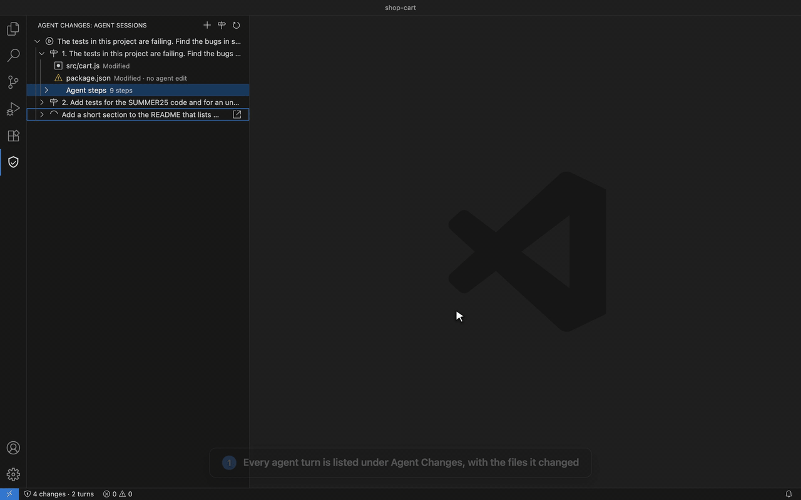
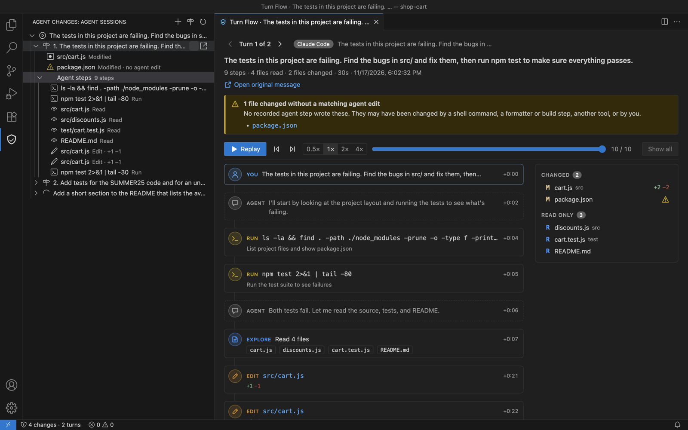
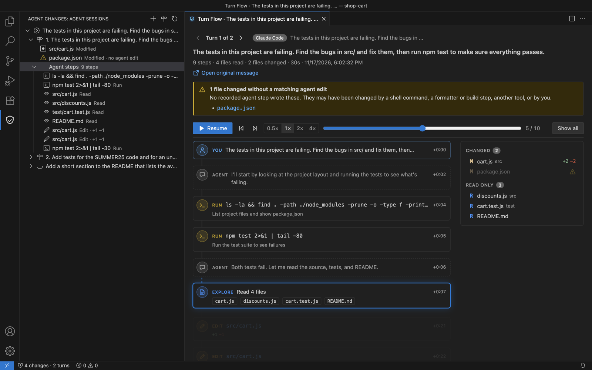
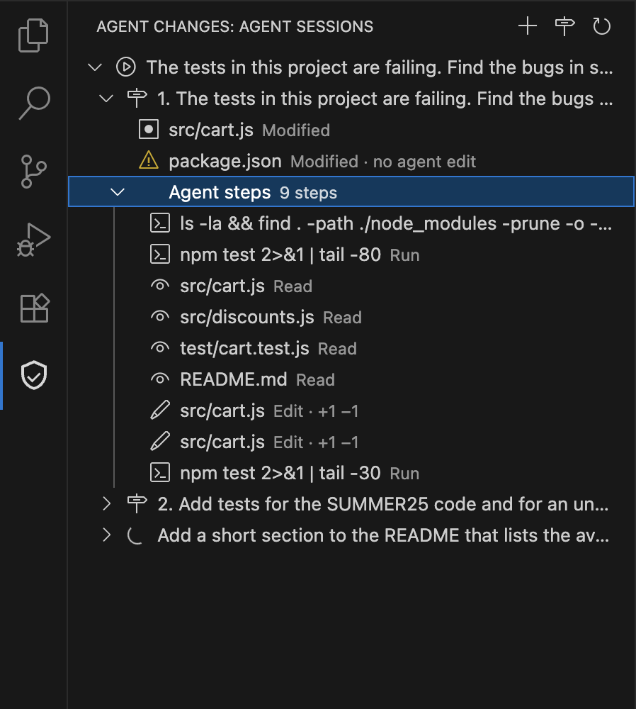

# Agent Change Guard

Track, diff, and revert every file change made during an AI agent session —
turn by turn. Works with **Claude Code** and the **OpenAI Codex CLI** out of
the box, and with Cursor Agent or manual work via sessions and manual
checkpoints, in VS Code or Cursor.

**It never touches git.** Baselines and checkpoints are plain file copies kept
in the extension's private storage, so reverting can't wipe your uncommitted
work, your index, or your stash.

## Why

AI agents can touch dozens of files in one turn. Before you accept that work,
you want to see exactly what changed — per message, not just per session — and
be able to rewind to any point, without committing first and without trusting
the agent's own summary.

## Features

- **Per-turn checkpoints**: with Claude Code and Codex, every user message
  automatically becomes a checkpoint labelled with that message. Expand a turn
  to see exactly which files it touched and diff each one against its state
  before the turn.
- **Auto session start**: the first agent message starts a session for you
  (configurable), so tracking begins without you remembering to.
- **Restore to checkpoint**: rewind the workspace to the end of any turn.
  Files changed by later turns are restored; earlier work is kept.
- **Open original message**: jump from a turn back to the closest supported
  Claude Code or Codex session/thread, with the exact local transcript line as
  fallback.
- **Turn Flow**: see *how* a turn happened, not just what changed. A
  flowchart of every step the agent took — files it read, searches, edits,
  commands (with failures), subagents and their own steps — ending in the files
  that changed, with an animated replay. Each turn also gets an **Agent steps**
  list in the sidebar.
- **Unattributed change warnings**: files a turn changed that no agent edit
  wrote (a shell command, formatter, build step, another tool, or you) are
  flagged in the sidebar and in Turn Flow.
- **Agent Changes** activity-bar view: sessions → turns → files, with
  `Created` / `Modified` / `Deleted` badges.
- Built-in diffs: per-turn (before ↔ after the turn) and cumulative
  (baseline ↔ current).
- Revert a single file, revert a whole session, or accept and keep changes.
- Explorer badges (✦) on files changed during the active session.
- Status bar counter showing changes and turns while recording.
- Content-based detection: files only appear if their bytes actually changed;
  a file edited back to its original content drops off the list.
- Respects your `.gitignore` plus a configurable ignore list.
- Changes made while the window was closed are picked up on reload.

## Usage with Claude Code or Codex

1. Run `Agent Change Guard: Start Session` (or click **＋** in the Agent
   Changes view) before — or while — the agent works. With auto-start on
   (the default), simply sending the agent a message starts a session.
2. Chat with the agent as usual. Each message you send closes out the previous
   turn into a checkpoint named after that message.
3. Expand a turn in the sidebar to see its files; click one for the
   before ↔ after diff of that turn.
4. Click the external-link action on a turn to reopen the related
   Claude Code/Codex session or thread when the platform supports it.
5. Right-click a turn → **Restore To Checkpoint** to rewind later work.
6. Click the flow icon on a turn (or the current turn) to open **Turn Flow**.

## Turn Flow



[Watch the demo in full quality (MP4)](docs/images/turn-flow-demo.mp4)

Turn Flow reconstructs a turn from the agent's own transcript: the user
message, then each step in order, then the files that changed.

### How to use it

1. Open **Agent Changes** in the activity bar. Each turn lists the files it
   changed and, under **Agent steps**, what the agent did.
2. Hover a turn and click its **flow icon** to open Turn Flow. You can also
   right-click a turn or a session → **Show Turn Flow**, or run
   `Agent Change Guard: Show Turn Flow` from the Command Palette.
3. Press **Replay** to play the turn back step by step.
4. Click a changed file to see what that turn changed.
5. Use **‹ ›** at the top to move between turns.



- **Replay** plays the turn back step by step, paced by the real time between
  steps (0.5×–4×). Files light up in the side panel as the agent touches them.
  Use the scrubber or ←/→ to move through it, Space to play or pause.

  

- Click a changed file (or the step that wrote it) for that turn's diff; click
  a read file to open it. Hover a file to highlight the steps that touched it.
- ‹ › moves between turns. The current turn updates live while the agent
  works, and keeps showing once it becomes a checkpoint.
- Files changed in a turn with no matching agent edit are called out at the
  top. They are checked only for finished turns with a readable transcript.

In the sidebar, each turn lists its **Agent steps**; click one to open the
file it wrote (as that turn's diff) or read. A file the turn changed without
a matching agent edit is marked **no agent edit**.



Turn Flow needs the turn's transcript, so it shows steps for Claude Code and
Codex turns only; manual checkpoints show their changed files. Nothing is
stored: steps are read from the transcript on demand, so a deleted transcript
means a files-only view.

Turn detection is automatic: Claude Code transcripts are tailed under
`~/.claude/projects/` and Codex rollout transcripts under `~/.codex/sessions/`.
Auto-start and auto-checkpoint can each be toggled per agent in settings.

## Usage with other agents (or by hand)

Start a session, let the agent work, and run
`Agent Change Guard: Create Checkpoint` whenever you want to mark a boundary.
Without checkpoints, a session shows a flat list of cumulative changes —
diff, revert per file, revert the session, or accept.

All commands are in the command palette under `Agent Change Guard: …`.

## Settings

| Setting | Default | Description |
| --- | --- | --- |
| `agentChangeGuard.ignoreDirectories` | `node_modules`, `.git`, `dist`, … | Directory names that are never tracked or snapshotted. |
| `agentChangeGuard.respectGitignore` | `true` | Also ignore files matched by the workspace root `.gitignore`. |
| `agentChangeGuard.maxFileSizeMB` | `5` | Files larger than this (in MB) are not snapshotted and cannot be reverted. |
| `agentChangeGuard.claudeCode.autoCheckpoint` | `true` | Create a checkpoint per Claude Code turn while a session is active. |
| `agentChangeGuard.claudeCode.autoStartSession` | `true` | Auto-start a session on the first Claude Code message when none is active. |
| `agentChangeGuard.codex.autoCheckpoint` | `true` | Create a checkpoint per Codex turn while a session is active. |
| `agentChangeGuard.codex.autoStartSession` | `true` | Auto-start a session on the first Codex message when none is active. |

## How it works

On **Start Session** the workspace (minus ignored paths and oversized files)
is copied into private extension storage as the baseline. While the session is
active, a file watcher records changes, comparing content hashes so no-op
saves don't count. At each turn boundary the changed files' contents are
stored as content-addressed blobs — that's what powers per-turn diffs and
restore.

Agent turns are detected by tailing transcript files: Claude Code under
`~/.claude/projects/` and the Codex CLI's rollout JSONL under
`~/.codex/sessions/`. Nothing is sent anywhere; transcripts are only read
locally to extract message boundaries, labels, and source locations for the
**Open Original Message** action.

Because reverts and restores only write from these private copies, your git
state and other uncommitted changes are left untouched. Accepting or removing
a session deletes its stored data.

## Limitations

- One session at a time; multi-root workspaces track only the first folder.
- Renames show as a delete plus a create.
- Files over the size limit are listed but cannot be diffed or restored.
- Claude Code and Codex expose session/thread-level links, not documented
  message-level deep links; **Open Original Message** opens the closest
  supported platform location and falls back to the local transcript line.
- Cursor Agent turns are not auto-detected yet (use manual checkpoints);
  auto-detection relies on Claude Code's and Codex's transcript file formats.

## Development

```bash
npm install
npm run compile      # bundle with esbuild (or: npm run watch)
npm run typecheck    # tsc --noEmit
```

Press **F5** in VS Code (*Run Extension*) to launch an Extension Development
Host with the extension loaded. Open a real project folder in that window
before starting a session.

```
src/
  extension.ts        // activation, command wiring, diffs, status bar
  sessionManager.ts   // session + checkpoint state, watcher, revert/restore
  snapshotManager.ts  // baseline copies + content-addressed checkpoint blobs
  claudeWatcher.ts    // tails Claude Code transcripts -> turn boundaries
  codexWatcher.ts     // tails Codex CLI rollout transcripts -> turn boundaries
  treeProvider.ts     // the Agent Changes tree view
  decorations.ts      // Explorer badges for agent-touched files
  types.ts            // shared types
  utils.ts            // ids, paths, ignore rules, hashing
```

Package a `.vsix` with `npm run package`.

## License

MIT
